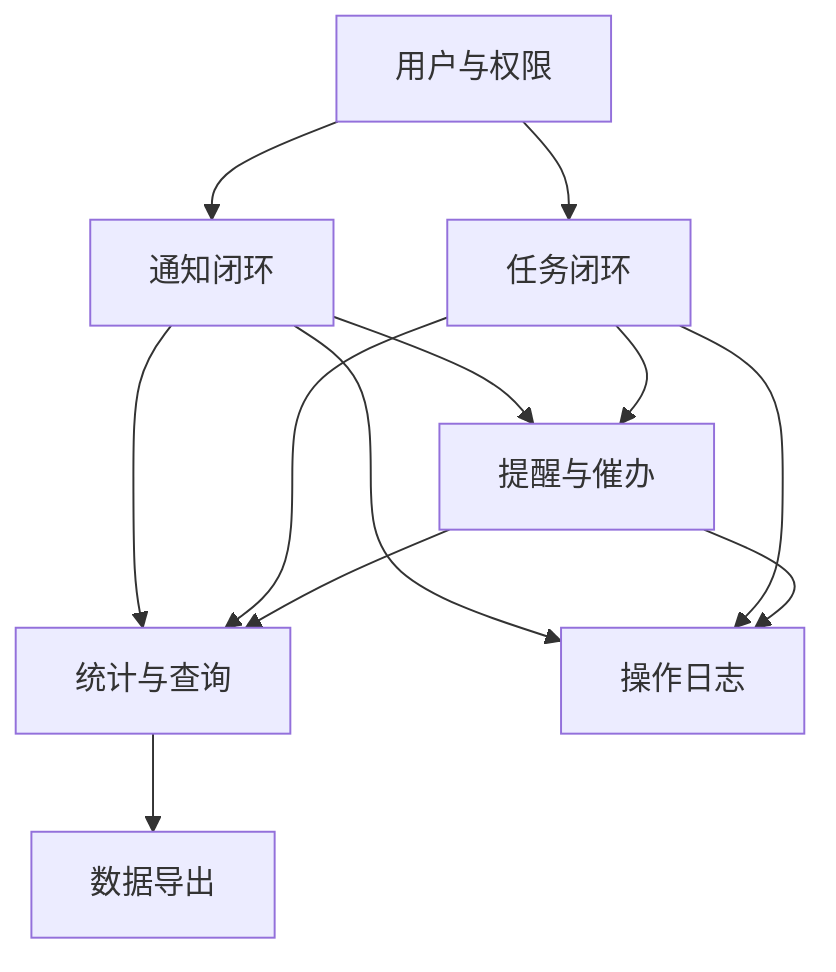
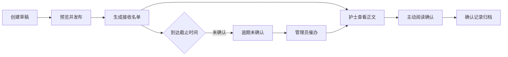
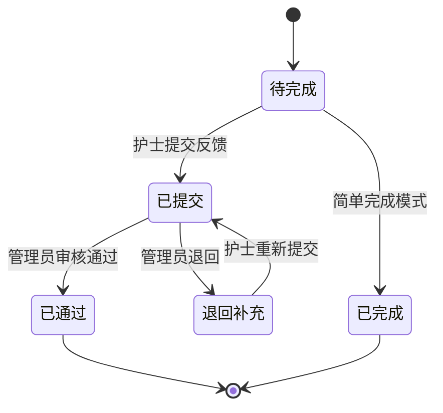
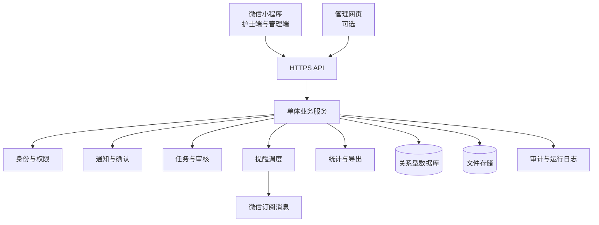
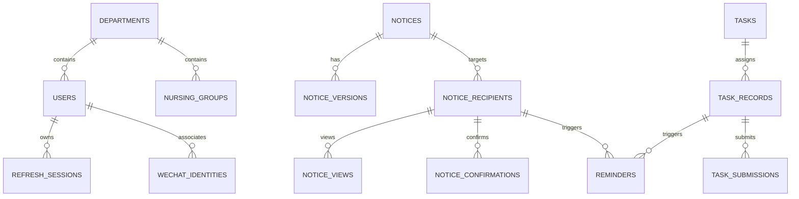

# 呼吸通 HXT V1.0 系统建设方案

> 本科室护理重要消息与任务闭环管理平台  
> 文档版本：V1.0  
> 编制日期：2026年11月18日  
> 适用范围：呼吸与危重症医学科，单科室 10～30 人护理团队

项目执行时以根目录 `PROJECT.md` 为入口，并同时遵循 `docs/product` 中的需求清单、登录绑定流程、权限矩阵、业务状态机、页面原型和验收基线。

---

## 1. 项目概述

### 1.1 项目背景

科室护理管理中的重要通知和工作任务通常通过微信群、口头交接或纸质记录传达。现有方式存在消息容易被刷屏、阅读情况无法确认、任务完成情况难以追踪、护士长需要反复人工催办等问题。

“呼吸通 HXT”拟建设为一款面向单科室护理团队的轻量级微信小程序，将重要通知与工作任务统一纳入线上闭环管理，形成“发布有对象、查看有记录、确认有时间、任务有反馈、逾期可追踪、操作可审计”的管理机制。

### 1.2 产品口号

**每条重要消息，都有回应。**

### 1.3 建设目标

V1.0 聚焦以下四个目标：

1. 护士长能够在 1 分钟内完成一条重要通知或工作任务的发布。
2. 护士能够快速查看本人相关事项，并完成阅读确认或任务反馈。
3. 管理人员能够随时查看已确认、未确认、已完成、待审核和逾期名单。
4. 系统能够完整保留发布、查看、确认、提交、审核和催办记录。

### 1.4 核心建设原则

- **轻量易用**：减少填写项和操作层级，适配护理人员碎片化使用场景。
- **通知与任务分离**：阅读确认用于证明知晓，任务完成用于证明执行，两者状态独立。
- **服务端留痕**：关键状态、人员和时间由服务端生成并保存。
- **权限最小化**：用户只能查看和处理与本人职责相关的数据。
- **数据最小化**：V1.0 仅保存科室工作信息和必要的人员信息。
- **提醒适应倒班**：允许设置合理期限，避免将休息日和夜间统一视为必须立即处理。
- **渐进建设**：先完成消息和任务闭环，再扩展培训、周期任务和数据看板。

---

## 2. 建设范围

### 2.1 V1.0 建设内容

| 模块 | 建设内容 |
| --- | --- |
| 用户与权限 | 微信身份绑定、角色识别、账号启停、协管员授权 |
| 人员管理 | 新增、导入、编辑、分组、在岗状态管理 |
| 通知管理 | 创建、预览、发布、分级、指定接收人、附件、截止时间、版本管理 |
| 阅读确认 | 详情查看、主动确认、确认时间、未确认与逾期名单 |
| 任务管理 | 创建任务、指定负责人、完成反馈、附件、提交与重新提交 |
| 任务审核 | 审核通过、退回补充、审核意见、关闭任务 |
| 提醒催办 | 站内提醒、订阅消息辅助提醒、人工催办、提醒结果记录 |
| 统计查询 | 首页概览、通知确认统计、任务完成统计、个人历史记录 |
| 日志审计 | 发布、修改、确认、提交、审核、催办、账号管理日志 |
| 数据导出 | 通知确认明细和任务处理明细导出 |

### 2.2 后续版本规划

- 培训资料、在线答题和培训签到。
- 月度质控、培训和考核等周期性任务。
- 月度趋势、分类统计和催办效果分析。
- 排班系统对接及当班人员自动识别。
- 多科室和院级组织管理。

### 2.3 V1.0 范围边界

V1.0 不建设绩效排名、人员积分、AI 自动评价、复杂培训考试、完整排班和患者信息管理。系统不得用于存储患者病历、身份证号码、具体病情、诊疗图片等敏感资料。

---

## 3. 用户角色与权限

### 3.1 角色定义

| 角色 | 说明 |
| --- | --- |
| 护士长 | 科室最高管理角色，负责人员、权限、通知、任务、审核、催办和导出 |
| 协管员 | 由护士长授权，可承担教育、质控等指定管理工作 |
| 普通护士 | 查看本人通知、完成阅读确认、提交本人任务、查询个人记录 |

### 3.2 权限矩阵

| 功能权限 | 护士长 | 协管员 | 普通护士 |
| --- | :---: | :---: | :---: |
| 查看本人通知和任务 | ✓ | ✓ | ✓ |
| 阅读确认 | ✓ | ✓ | ✓ |
| 提交本人任务 | ✓ | ✓ | ✓ |
| 发布通知和任务 | ✓ | 按授权 | — |
| 查看全科统计 | ✓ | 按授权 | — |
| 发起催办 | ✓ | 按授权 | — |
| 审核任务 | ✓ | 按授权 | — |
| 管理人员和权限 | ✓ | — | — |
| 导出管理记录 | ✓ | 按授权 | — |

### 3.3 权限实现原则

协管员权限按功能单独授权，包括发布、统计、催办、审核和导出。接口层必须再次校验用户角色、科室归属和数据范围，不能只依赖前端隐藏菜单。

---

## 4. 业务架构



### 4.1 通知闭环



通知状态须区分：

- **已发布**：服务端已生成通知及接收人名单。
- **已推送**：消息渠道返回发送成功，不代表用户已经阅读。
- **已查看**：接收人已经打开通知详情页。
- **已确认**：接收人主动点击“我已阅读并知晓”。
- **逾期未确认**：到达确认期限后仍未确认。

### 4.2 任务闭环



任务支持两种完成模式：

| 模式 | 护士端操作 | 完成条件 |
| --- | --- | --- |
| 简单完成 | 点击“已完成” | 服务端记录完成时间 |
| 审核完成 | 填写反馈或上传附件 | 管理员审核通过 |

### 4.3 通知修改规则

- 发布前允许直接编辑草稿。
- 发布后修改标题、正文、附件、接收范围或截止时间时生成新版本。
- 每条确认记录必须关联具体通知版本。
- 涉及执行要求、风险说明或截止时间的重要变更，可要求接收人重新确认。
- 历史版本仅管理员可查，普通护士默认查看当前生效版本。

---

## 5. 功能设计

### 5.1 护士端

底部导航设置为“首页、消息、任务、我的”。

#### 5.1.1 首页

- 展示待确认消息数量、待完成任务数量和最近的重要提醒。
- 优先显示紧急、临近截止和已逾期事项。
- 点击卡片直接进入对应详情。
- 已完成事项从待办区域移除，并进入个人历史记录。

#### 5.1.2 消息

- 支持待确认、全部、已确认、已逾期筛选。
- 列表显示等级、标题、发布时间、截止时间和本人状态。
- 详情页记录首次查看时间。
- 阅读完整正文后显示“我已阅读并知晓”按钮。
- 确认成功后展示服务端确认时间，按钮不可重复提交。

#### 5.1.3 任务

- 支持待完成、已提交、退回补充、已完成筛选。
- 任务详情显示要求、负责人、完成方式、截止时间和附件。
- 审核完成模式支持填写文字反馈和上传凭证。
- 退回任务展示审核意见和历史提交记录。
- 重复提交时生成新的提交版本，保留历史版本。

#### 5.1.4 我的

- 展示姓名、角色、科室和账号状态。
- 查询本人通知确认记录和任务记录。
- 管理订阅消息授权状态。
- 查看隐私说明、帮助说明和系统版本。

### 5.2 管理端

管理功能在同一小程序中按角色展示。批量导入、复杂筛选和文件导出可提供适配电脑浏览器的管理页面。

#### 5.2.1 管理首页

- 展示待确认人数、待完成任务、待审核事项和逾期数量。
- 展示近期发布内容及处理进度。
- 提供发布通知、发布任务、审核任务和催办的快捷入口。

#### 5.2.2 发布中心

- 选择“阅读确认通知”或“工作任务”。
- 填写标题、正文、重要程度、截止时间和附件。
- 按全员、分组或指定人员选择接收对象。
- 任务需配置负责人、完成方式和是否需要审核。
- 发布前展示规则预览、接收人数和截止时间。
- 正式发布前进行二次确认。

#### 5.2.3 通知管理

- 查看已发布通知、草稿和已关闭通知。
- 查看接收人数、已查看人数、已确认人数和逾期人数。
- 按状态筛选人员，并查看查看时间、确认时间和提醒记录。
- 对未确认人员发起批量或单人催办。
- 导出确认明细。

#### 5.2.4 任务管理

- 查看任务进度、待审核反馈和逾期任务。
- 查看每次提交的内容、附件和提交时间。
- 执行审核通过或退回补充，并填写审核意见。
- 对未提交人员发起催办。
- 在所有负责人完成后关闭任务。

#### 5.2.5 人员管理

- 新增、批量导入和编辑人员。
- 配置角色、分组、协管员权限和在岗状态。
- 停用离科人员账号，保留其历史业务记录。
- 为新成员生成待绑定账号，完成身份核验后绑定微信身份。

---

## 6. 通知等级与提醒策略

| 等级 | 适用场景 | 默认时限 | 提醒策略 |
| --- | --- | --- | --- |
| 紧急 | 当班需及时知晓的安全风险、临时工作调整 | 管理员指定，可设置 30 分钟 | 立即站内提醒，合规订阅消息辅助，未确认人员人工跟进 |
| 重要 | 质控整改、业务学习、会议通知 | 24 小时 | 发布提醒、截止前提醒、逾期进入待跟进名单 |
| 普通 | 常规工作信息、一般会议纪要 | 可选 | 站内展示，可配置是否要求确认 |

### 6.1 提醒规则

- 站内待办是基础提醒方式。
- 微信订阅消息作为辅助提醒方式，并记录授权和发送结果。
- 推送成功只表示渠道接收成功，不改变查看或确认状态。
- 每次人工催办记录操作人、对象、时间、渠道和结果。
- 同一事项设置提醒间隔与次数上限，避免频繁打扰。
- 紧急事项页面提示管理员结合电话、交接班或院内规定方式完成可靠通知。

### 6.2 倒班适配

- 支持“全员知晓”和“当班必读”两种接收范围语义。
- V1.0 没有排班数据时，由管理员手工指定当班人员。
- 发布人可以设置绝对截止时间，系统显示剩余时间。
- 逾期状态用于管理跟进，不由系统自动判定为工作违规。

---

## 7. 页面信息架构

```text
呼吸通小程序
├─ 护士端
│  ├─ 首页
│  │  ├─ 待确认消息
│  │  ├─ 待完成任务
│  │  └─ 重要提醒
│  ├─ 消息
│  │  ├─ 消息列表
│  │  └─ 消息详情与确认
│  ├─ 任务
│  │  ├─ 任务列表
│  │  └─ 任务详情与反馈
│  └─ 我的
│     ├─ 个人资料
│     ├─ 我的记录
│     └─ 系统帮助
└─ 管理端
   ├─ 管理首页
   ├─ 发布中心
   ├─ 通知管理
   ├─ 任务管理
   └─ 人员管理
```

---

## 8. 系统技术架构

### 8.1 总体架构

针对单科室 10～30 人的规模，V1.0 采用单体业务服务，减少部署和运维复杂度。



### 8.2 推荐技术选型

项目采用 TypeScript 全栈方案。小程序与 H5 共用一套业务前端，服务端采用模块化单体架构，前后端在同一代码仓库中管理并共享接口契约。

| 层级 | 推荐方案 | 说明 |
| --- | --- | --- |
| 小程序与 H5 | uni-app + Vue 3 + TypeScript | 一套业务代码发布到微信小程序和 H5 |
| 状态管理 | Pinia | 管理登录用户、权限、待办数量和页面状态 |
| 电脑管理端 | Vue 3 + TypeScript | V1.0 可按需建设，适合批量管理、复杂表格和导出 |
| 服务端 | Node.js + NestJS + TypeScript | 支持模块、守卫、参数校验、任务调度和 OpenAPI |
| 数据库 | PostgreSQL | 支持事务、约束、索引和可靠的业务状态存储 |
| 数据访问 | Prisma ORM | 统一数据库模型、迁移和类型安全的数据访问 |
| 缓存与队列 | Redis + BullMQ | 承载提醒任务、异步处理、频率控制和短期缓存 |
| 文件存储 | 医院允许的对象存储或院内文件服务 | 保存通知附件和任务反馈凭证 |
| 接口规范 | RESTful JSON + OpenAPI | 统一小程序、H5 和管理端的接口契约 |
| 仓库管理 | pnpm workspace monorepo | 统一管理应用、共享类型和工程配置 |
| 部署 | Docker + Nginx + Linux 服务器 | 便于环境统一、版本发布和回滚 |
| 监控 | 结构化日志、健康检查、错误告警 | 保障试运行期间问题可定位 |

技术选型可根据医院现有基础设施调整。若医院已有统一身份认证、数据库、对象存储和消息平台，应优先完成兼容性评估并复用现有能力。

### 8.3 代码仓库结构

```text
NurseMate
├─ apps
│  ├─ client                 # uni-app，小程序与 H5 共用业务前端
│  ├─ api                    # NestJS 后端服务
│  │  └─ prisma              # 数据库模型、迁移和初始化数据
│  └─ admin-web              # 电脑管理端，按 V1.0 实际需要启用
├─ packages
│  ├─ contracts              # 前后端共享接口类型和状态枚举
│  ├─ validation             # 可跨端复用的输入校验规则
│  └─ constants              # 角色、权限、通知等级等公共常量
├─ docs
│  ├─ architecture           # 架构决策和模块设计
│  ├─ api                    # 接口约定及联调说明
│  ├─ operations             # 云端测试环境和运维规范
│  ├─ product                # V1.0 需求、权限、状态机和验收基线
│  └─ prototype              # 关键页面可点击原型
├─ infra
│  ├─ docker                 # 容器构建与编排配置
│  └─ nginx                  # 网关和静态资源配置
├─ scripts                   # 开发、检查、发布和数据维护脚本
├─ HXT-V1.0-系统建设方案.md  # 项目建设主文档
├─ PROJECT.md                # 项目执行入口和交付清单
├─ AGENTS.md                 # 后续开发协作约束
├─ package.json              # 工作区统一命令和 Node.js 版本约束
└─ pnpm-workspace.yaml       # monorepo 工作区定义
```

目录职责遵循以下约束：

- `apps` 只放置可独立构建和部署的应用。
- `packages` 只放置被两个及以上应用复用的代码，不放具体页面和业务流程。
- 数据库结构、迁移和初始化数据归属 `apps/api/prisma`，由后端统一管理。
- 微信身份关联、订阅消息和文件选择等平台差异集中在 `apps/client` 的平台适配层。
- 接口类型可以共享，服务端仍需对每次请求执行权限和数据校验。
- 环境变量只提交示例文件，真实密钥不得进入代码仓库。

### 8.4 跨端实现约束

小程序与 H5 共享页面组件、业务状态和接口调用层，同时为平台能力建立独立适配：

| 功能 | 微信小程序 | H5 |
| --- | --- | --- |
| 用户登录 | 工号与密码登录，登录后关联微信身份 | 使用同一工号与密码登录 |
| 消息提醒 | 站内待办与微信订阅消息 | 站内待办，按医院条件接入短信或企业消息 |
| 文件上传 | 使用小程序文件和图片接口 | 使用浏览器文件选择接口 |
| 页面分享 | 微信小程序分享能力 | 普通网页链接或二维码 |
| 版本发布 | 提交微信审核后发布 | 部署 Web 静态资源后发布 |

平台差异不得直接散落在业务页面中。页面通过统一接口调用平台适配层，保证通知、任务、确认和审核逻辑在两个端保持一致。

### 8.5 环境划分

- **本地工作区**：只用于代码和文档编辑、静态检查与版本控制，不在本地启动业务依赖或进行部署测试。
- **云端测试环境**：用于构建、数据库迁移、研发联调、自动化检查、产品验收和试运行前验证，部署根目录固定为 `/apps/NurseMate`。
- **生产环境**：正式科室数据，限制开发人员直接访问，并与测试环境完全隔离。

云端测试环境与生产环境使用独立数据库、文件空间、配置和微信应用参数。服务器连接凭据、微信 AppSecret 和数据库密码通过仓库外渠道管理，具体执行遵循 [云端测试环境规范](./docs/operations/cloud-test-environment.md)。

---

## 9. 数据模型设计

### 9.1 核心实体关系



完整字段、索引与外键以 [数据模型初稿](./docs/architecture/data-model.md) 和 `apps/api/prisma/schema.prisma` 为准。业务主键统一使用 UUID；微信身份、账号会话与内部用户身份分离。

### 9.2 核心数据表

| 表名 | 主要用途 |
| --- | --- |
| `departments`、`nursing_groups`、`users` | 单科室、护理分组和人员账号 |
| `activation_codes`、`wechat_identities`、`refresh_sessions` | 激活、密码重置、微信关联和设备会话 |
| `user_permissions` | 协管员的细粒度授权 |
| `notices` | 通知主记录、等级、当前版本、发布时间和截止时间 |
| `notice_versions` | 通知各版本的正文、附件和修改说明 |
| `notice_recipients`、`notice_views`、`notice_confirmations` | 固定接收名单及按版本保存的查看、确认事实 |
| `tasks` | 任务要求、完成模式、截止时间和整体状态 |
| `task_records` | 每名负责人的任务执行状态和完成时间 |
| `task_submissions` | 多次提交内容、审核结果和审核意见 |
| `file_objects` 及附件关联表 | 文件元数据和通知、任务、反馈附件关系 |
| `reminders` | 提醒渠道、发送时间、发送结果和次数 |
| `export_jobs` | 异步导出状态、筛选快照、结果文件和有效期 |
| `audit_logs` | 关键操作的人员、时间、对象和结果 |
| `idempotency_records` | 写接口防重与首次响应保存 |

### 9.3 数据约束

- 同一通知和用户只能存在一条有效接收记录。
- 同一通知版本和用户只能成功确认一次，接口需具备幂等性。
- 已发布通知的接收名单形成快照，后续人员变动不应自动改变历史名单。
- 任务提交序号单调递增，审核记录不得覆盖历史提交。
- 用户停用后保留业务外键关系和历史显示姓名。
- 数据库统一保存标准时间，前端按中国标准时间展示。

---

## 10. 接口设计

接口统一采用 HTTPS 和 JSON，基础路径为 `/api/v1`，业务写入接口使用 `Idempotency-Key` 避免网络重试造成重复操作。完整路径、字段、响应、权限标记和枚举以 [OpenAPI 初稿](./docs/api/openapi.yaml) 为准。

### 10.1 身份与人员接口

| 方法 | 路径 | 用途 |
| --- | --- | --- |
| `POST` | `/api/v1/auth/activate` | 使用工号和激活码首次激活并设置密码 |
| `POST` | `/api/v1/auth/login` | 小程序与 H5 使用账号密码登录 |
| `POST` | `/api/v1/auth/reset-password` | 使用一次性重置码重置密码 |
| `POST` | `/api/v1/auth/wechat/associate` | 小程序登录后关联微信身份 |
| `GET` | `/api/v1/me` | 获取当前用户和权限 |
| `GET/POST` | `/api/v1/users` | 查询或新增科室人员 |
| `PATCH` | `/api/v1/users/{userId}` | 修改角色、分组或状态 |

### 10.2 通知接口

| 方法 | 路径 | 用途 |
| --- | --- | --- |
| `GET/POST` | `/api/v1/notices` | 查询可管理通知或创建草稿 |
| `PATCH` | `/api/v1/notices/{noticeId}` | 修改草稿或创建新版本 |
| `POST` | `/api/v1/notices/{noticeId}/publish` | 发布通知并固定接收名单 |
| `GET` | `/api/v1/me/notices` | 查询本人通知列表 |
| `GET` | `/api/v1/me/notices/{noticeId}` | 查看通知详情并记录首次查看 |
| `POST` | `/api/v1/me/notices/{noticeId}/confirm` | 确认指定通知版本 |
| `GET` | `/api/v1/notices/{noticeId}/recipients` | 查询确认明细 |
| `POST` | `/api/v1/notices/{noticeId}/reminders` | 发起催办 |

### 10.3 任务接口

| 方法 | 路径 | 用途 |
| --- | --- | --- |
| `GET/POST` | `/api/v1/tasks` | 查询可管理任务或创建草稿 |
| `POST` | `/api/v1/tasks/{taskId}/publish` | 发布任务并固定负责人名单 |
| `GET` | `/api/v1/me/tasks` | 查询本人任务列表 |
| `GET` | `/api/v1/me/tasks/{taskId}` | 查询本人任务详情 |
| `POST` | `/api/v1/me/tasks/{taskId}/complete` | 完成简单任务 |
| `POST` | `/api/v1/me/tasks/{taskId}/submissions` | 提交或重新提交反馈 |
| `POST` | `/api/v1/tasks/{taskId}/records/{recordId}/review` | 审核通过或退回补充 |
| `GET` | `/api/v1/tasks/{taskId}/records` | 查询任务执行明细 |

### 10.4 统计与导出接口

| 方法 | 路径 | 用途 |
| --- | --- | --- |
| `GET` | `/api/v1/dashboard/management` | 查询管理概览 |
| `POST` | `/api/v1/exports` | 创建受审计的通知或任务明细导出 |

---

## 11. 安全与合规设计

### 11.1 身份安全

- 护士账号由管理员预建，用户不能仅凭姓名自行注册。
- 首次激活需使用一次性激活码，激活后小程序与 H5 共用同一账号密码。
- 微信身份与系统用户建立唯一关联，用于订阅消息等微信能力，不作为唯一登录条件。
- 账号停用后立即禁止登录和业务操作。
- 敏感管理操作可要求再次确认或进行会话有效性校验。

### 11.2 权限与接口安全

- 每个接口校验登录状态、科室归属、角色和具体权限。
- 普通护士只能访问本人接收的通知和本人负责的任务。
- 文件下载使用短时有效的授权地址。
- 对登录、发布、确认、提交、审核和导出接口实施频率限制。
- 输入内容进行长度、格式、文件类型和文件大小校验。

### 11.3 数据安全

- 全链路使用 HTTPS。
- 密钥、数据库密码和微信应用凭据使用独立配置管理，不写入代码仓库。
- 数据库和文件按医院要求定期备份，并验证恢复流程。
- 生产数据访问遵循最小权限，记录管理人员导出行为。
- 明确数据保存期限、备份保留期限、人员离科后的数据处理规则。

### 11.4 审计要求

以下操作必须记录审计日志：

- 用户登录、绑定、解绑、启用和停用。
- 人员、角色和协管员权限变更。
- 通知创建、发布、修改、重新确认要求和关闭。
- 阅读确认、任务提交、审核通过和退回补充。
- 单人或批量催办。
- 数据查询导出和文件下载。

日志至少包含操作人、操作时间、业务对象、动作、结果和必要的变更摘要。普通用户不得修改或删除审计日志。

---

## 12. 非功能需求

| 类别 | V1.0 指标 |
| --- | --- |
| 可用性 | 主要页面操作路径不超过 3 层，常用操作提供明确成功反馈 |
| 性能 | 正常网络下主要列表和详情接口 95% 请求在 2 秒内返回 |
| 容量 | 支持单科室 30 名用户，预留扩展至 100 名用户的能力 |
| 并发 | 支持 50 个并发在线请求，不发生状态错乱或重复记录 |
| 可靠性 | 确认、提交和审核操作具备幂等控制和事务一致性 |
| 可追溯性 | 关键业务操作可按用户、对象和时间查询 |
| 可恢复性 | 数据库定期备份，正式上线前完成一次恢复演练 |
| 兼容性 | 支持科室实际使用的主流微信版本和手机屏幕尺寸 |
| 可维护性 | 开发、测试、生产配置分离，提供日志和健康检查 |

---

## 13. 界面与体验规范

### 13.1 视觉方向

- 品牌主色采用院徽中的深青蓝 `#005870` 和主青蓝 `#0088A0`。
- 辅助色采用院徽中的薄荷绿 `#88C8B8`，用于辅助图形和柔和状态背景。
- 暖橙色用于临近截止和一般提醒。
- 红色仅用于紧急、逾期和高风险操作。
- 页面以白色背景和卡片布局为主，保证信息清晰。
- 状态必须同时显示文字，不能仅依赖颜色区分。

### 13.2 交互规范

- 首页首先呈现用户需要处理的事项。
- 确认和提交操作显示加载、成功或失败结果。
- 防止按钮重复点击导致多次请求。
- 发布、批量催办、审核退回等管理操作显示影响人数和业务结果。
- 表单离开前保留草稿或提示未保存内容。
- 截止时间同时展示日期、时间和剩余时间。

---

## 14. 项目实施计划

建议采用 10 周建设周期，实际时间根据团队配置、医院审批和微信主体准备情况调整。

| 阶段 | 周期 | 主要工作 | 交付物 |
| --- | --- | --- | --- |
| 需求确认与原型 | 第 1～2 周 | 场景访谈、流程确认、页面原型、验收用例 | 需求规格、交互原型、评审纪要 |
| 基础能力开发 | 第 3～4 周 | 登录绑定、人员、角色权限、文件上传、日志基础 | 可联调基础版本 |
| 通知闭环开发 | 第 5～6 周 | 通知发布、接收名单、查看、确认、统计、催办 | 通知闭环测试版本 |
| 任务闭环开发 | 第 7～8 周 | 任务发布、反馈、审核、退回、提醒、导出 | 完整 V1.0 测试版本 |
| 测试与修复 | 第 9 周 | 功能、权限、兼容性、异常和数据一致性测试 | 测试报告、修复清单 |
| 试运行与上线 | 第 10 周 | 培训、小范围试运行、数据核对、发布和监控 | 上线版本、操作手册、验收报告 |

### 14.1 建议团队配置

| 角色 | 建议投入 | 职责 |
| --- | --- | --- |
| 产品经理或产品工程师 | 1 人 | 需求、流程、原型、验收和试运行协调 |
| UI 设计师 | 0.5 人 | 视觉规范和关键页面设计 |
| 小程序开发工程师 | 1 人 | 护士端和移动管理端开发 |
| 后端开发工程师 | 1 人 | 接口、数据库、权限、调度和导出 |
| 测试工程师 | 0.5～1 人 | 测试用例、权限测试、兼容性和回归测试 |
| 运维或信息科支持 | 按需 | 环境、域名、证书、备份和上线支持 |

---

## 15. 测试方案

### 15.1 重点测试类型

- **业务流程测试**：覆盖通知和任务从创建到归档的完整流程。
- **角色权限测试**：逐项验证护士长、协管员和普通护士的数据范围。
- **状态流转测试**：验证重复确认、重复提交、退回重提、逾期和关闭场景。
- **异常测试**：覆盖弱网、重复点击、请求超时、文件上传失败和消息发送失败。
- **数据一致性测试**：核对首页数量、明细名单、导出数据和数据库记录。
- **兼容性测试**：覆盖科室常用手机、微信版本、字体大小和网络环境。
- **安全测试**：验证越权访问、非法参数、文件类型限制和接口频率控制。

### 15.2 核心测试场景

1. 护士长向 10 人发布一条需确认通知，系统生成固定的 10 人接收名单。
2. 6 人完成确认后，管理端准确显示 6 人已确认、4 人未确认及对应时间。
3. 对 4 名未确认人员催办后，提醒记录可查询，确认状态不被自动改变。
4. 通知重要内容生成新版本后，按配置要求相关人员重新确认。
5. 护士提交审核任务，管理员退回补充，护士重新提交后审核通过。
6. 重复点击确认、提交或审核按钮时，系统不产生重复业务记录。
7. 普通护士尝试访问他人任务或管理接口时，系统拒绝请求。
8. 人员停用后不能登录，但历史确认和任务记录仍可查询。

---

## 16. 上线与运维方案

### 16.1 上线准备

- 完成微信小程序主体、类目、隐私说明和相关审核材料准备。
- 确认服务器、域名、HTTPS 证书、数据库和文件存储环境。
- 完成医院内部审批、数据范围确认和管理员授权。
- 初始化科室人员和角色，清理全部测试数据。
- 完成数据库备份与恢复演练。
- 提供护士端快速指引和管理员操作手册。

### 16.2 试运行建议

首批选择护士长、1 名协管员和 5～8 名不同班次护士，使用真实但不包含患者信息的科室通知和工作任务试运行 1～2 周。重点记录操作步骤、提醒时机、确认准确性、任务反馈便利性和管理统计一致性。

### 16.3 运行监控

- 监控接口错误率、响应时间、登录失败和消息发送失败。
- 监控数据库连接、磁盘容量、文件存储和备份结果。
- 对连续失败的定时任务和批量提醒进行告警。
- 生产问题记录发生时间、影响范围、处理过程和最终原因。

---

## 17. 验收标准

### 17.1 功能验收

- 护士长可以创建、预览并向指定人员发布通知和任务。
- 护士只能查看本人相关内容，并可完成确认或任务反馈。
- 管理端准确展示已查看、已确认、未确认、已完成、待审核和逾期名单。
- 审核任务支持通过、退回补充和再次提交。
- 催办操作有明确结果并保留提醒记录。
- 人员停用、角色授权和协管员权限配置立即生效。
- 通知确认明细和任务处理明细可以导出。

### 17.2 数据验收

- 接收名单与发布时选择结果完全一致。
- 查看、确认、提交和审核时间均由服务端记录。
- 通知确认记录关联具体版本。
- 统计数量与人员明细一致。
- 重复请求不产生重复确认、提交或审核记录。
- 历史版本、退回记录和操作日志能够完整追溯。

### 17.3 上线验收场景

以“一条全员质控整改通知”和“一项需要审核的培训任务”为验收样例，完整验证发布、查看、确认、催办、提交、退回、重新提交、审核通过和导出流程。两条业务记录均能按人员和时间完整追溯后，视为核心闭环验收通过。

---

## 18. 项目风险与应对

| 风险 | 影响 | 应对措施 |
| --- | --- | --- |
| 微信订阅消息授权次数有限 | 无法保证持续站外推送 | 以站内待办为基础，订阅消息辅助，紧急事项人工跟进 |
| 护士倒班导致确认延迟 | 截止时间不合理，引发使用抵触 | 支持自定义期限、当班必读和全员知晓，试运行校准规则 |
| 发布内容误发或接收人选错 | 产生错误通知和统计 | 发布前预览、显示影响人数、二次确认、完整审计 |
| 通知修改后确认含义不清 | 旧确认无法证明已知晓新内容 | 使用通知版本并配置是否重新确认 |
| 管理员过度使用紧急等级 | 重要信息失去区分度 | 提供明确使用标准并在统计中观察使用情况 |
| 附件包含患者敏感信息 | 产生数据安全风险 | 页面提示、文件规则、管理员培训和院内制度约束 |
| 本地状态与服务器不一致 | 统计错误或重复操作 | 服务端为唯一数据源，关键写入使用事务和幂等控制 |

---

## 19. 交付物清单

项目完成时应交付：

1. 产品需求规格说明书和确认后的交互原型。
2. UI 设计稿、颜色字体规范和图标资源。
3. 微信小程序源代码及构建说明。
4. 服务端源代码、数据库脚本和接口文档。
5. 部署配置、环境变量清单和发布说明。
6. 测试用例、测试报告和问题关闭清单。
7. 数据备份与恢复操作说明。
8. 护士端快速使用指引和管理员操作手册。
9. 上线检查表、试运行记录和项目验收报告。

---

## 20. 建设结论

呼吸通 HXT V1.0 以单科室微信小程序和 H5 为主要载体，围绕通知发布、阅读确认、任务执行、审核反馈、统计催办和操作留痕建设完整业务闭环。系统采用 uni-app、Vue 3、TypeScript、NestJS 和 PostgreSQL 构成的模块化单体架构，满足 10～30 人护理团队的使用规模，并通过共享接口契约、服务端状态管理和权限控制保证记录准确可靠。

首个可运行版本应优先完成“发布通知—固定接收名单—护士确认—未确认统计—人工催办”闭环，在此基础上接入任务提交与审核流程。经过小范围试运行验证倒班场景、提醒规则和统计准确性后，再推广至全科室使用，并根据实际需求规划培训、周期任务和院级扩展能力。
