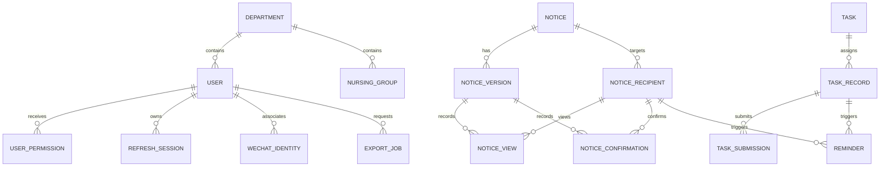

# V1.0 数据模型初稿

> 实现来源：`apps/api/prisma/schema.prisma`  
> 状态：初稿，首次迁移前需要通过 Prisma 校验和数据库评审

## 1. 设计目标

- 所有业务记录以内部 `user_id` 关联人员。
- 已发布通知、接收名单、确认、任务提交和审核历史不可物理覆盖。
- 关键时间使用 PostgreSQL `timestamptz`，由服务端生成。
- 逾期为派生状态，不单独保存容易失真的布尔字段。
- 写入操作具备事务、唯一约束、乐观并发或幂等记录。
- 微信身份、密码会话与业务身份分离。

## 2. 模块与数据表

| 模块 | 数据表 | 用途 |
| --- | --- | --- |
| 组织人员 | `departments`、`nursing_groups`、`users` | 科室、分组和人员账号 |
| 身份认证 | `activation_codes`、`wechat_identities`、`refresh_sessions` | 激活、密码重置、微信关联和会话 |
| 权限 | `permissions`、`user_permissions` | 协管员细粒度权限 |
| 通知 | `notices`、`notice_versions`、`notice_recipients` | 通知主记录、版本和接收快照 |
| 通知留痕 | `notice_views`、`notice_confirmations` | 每个通知版本的查看与确认记录 |
| 任务 | `tasks`、`task_records`、`task_submissions` | 任务、负责人状态和多次提交审核 |
| 文件 | `file_objects` 及三张附件关联表 | 文件元数据及通知、任务、反馈附件 |
| 提醒 | `reminders` | 站内、微信订阅消息和人工催办记录 |
| 导出 | `export_jobs` | 异步导出状态、筛选快照、结果文件和有效期 |
| 审计与可靠性 | `audit_logs`、`idempotency_records` | 不可变审计与重复请求防护 |

## 3. 核心关系

## 4. 账号与身份规则

- `users.employee_no` 在 V1.0 保持系统唯一，作为小程序和 H5 登录名。
- `password_hash` 只保存密码摘要，待激活账号允许为空。
- 激活码与重置码共用 `activation_codes`，通过 `purpose` 区分。
- 生成新激活码或重置码时，使同用途旧码失效。
- 微信关联使用 `app_id + open_id` 唯一约束，并使用 `user_id + app_id` 保证一名用户在同一小程序仅有一个当前关联。
- 刷新令牌只保存摘要，退出、停用和改密通过 `revoked_at` 失效。

## 5. 通知版本与确认

- `notices` 保存用于列表查询的当前标题、等级、期限和当前版本号。
- `notice_versions` 保存每个版本的完整正文、级别、期限和重新确认规则。
- 发布时生成 `notice_recipients` 快照，人员与分组变化不影响历史名单。
- `notice_views` 与 `notice_confirmations` 按接收人和版本唯一。
- 当前确认状态由当前通知版本、是否要求重新确认以及历史确认记录计算。
- 排除接收人只填写 `excluded_at`、操作人和原因，不删除记录。

## 6. 任务提交与审核

- `task_records` 为每名负责人保存当前执行状态。
- `tasks` 固定完成模式、反馈要求和附件要求；发布后不得切换模式或实质修改要求。
- `task_submissions.submission_no` 在同一任务记录中递增并唯一。
- 退回后重新提交新增记录，不修改之前提交。
- 审核更新时同时检查 `task_records.status` 与 `lock_version`，防止重复审核。
- 已提交待审核的任务在截止后不计为护士逾期。

## 7. 数据库级约束

Prisma 首次迁移后需要补充 PostgreSQL 原生约束：

1. `reminders` 必须且只能关联一个目标：`notice_recipient_id` 或 `task_record_id`。
2. 提醒目标字段必须与 `target_type` 一致。
3. `notice_versions.version_no`、`task_submissions.submission_no` 必须大于 0。
4. `file_objects.size_bytes` 必须大于 0。
5. 审计日志表禁止业务角色执行 `UPDATE` 和 `DELETE`。
6. `DISABLED` 用户必须具有 `disabled_at`。

## 8. 关键索引

- 用户：科室 + 状态、科室 + 角色、主要分组。
- 通知：科室 + 状态 + 发布时间、科室 + 截止时间。
- 通知接收人：用户 + 排除时间。
- 任务：科室 + 状态 + 发布时间、科室 + 截止时间。
- 任务记录：负责人 + 当前状态。
- 提醒：状态 + 计划时间、接收人 + 创建时间。
- 审计：科室 + 时间、操作人 + 时间、业务对象 + 时间。
- 幂等记录：过期时间，用于定期清理。
- 导出任务：状态 + 请求时间、请求人 + 请求时间。

## 9. 事务边界

| 操作 | 同一事务内完成 |
| --- | --- |
| 激活账号 | 校验激活码、设置密码、更新账号、使用激活码、写审计 |
| 发布通知 | 更新通知、创建首版本、生成接收人快照、创建提醒计划、写审计 |
| 确认通知 | 校验接收人与版本、创建确认、取消待提醒、写审计 |
| 发布任务 | 更新任务、生成负责人记录、创建提醒计划、写审计 |
| 提交任务 | 创建提交版本、更新任务记录状态、写审计 |
| 审核任务 | 更新提交审核结果、更新任务记录状态、写审计 |

## 10. 待首次迁移验证

- 运行 `prisma format` 和 `prisma validate`。
- 生成并检查首个 SQL migration。
- 补充 Prisma 无法表达的 `CHECK` 约束。
- 验证所有外键的删除行为均不会破坏历史记录。
- 使用验收基线中的 12 名测试用户生成种子数据。

