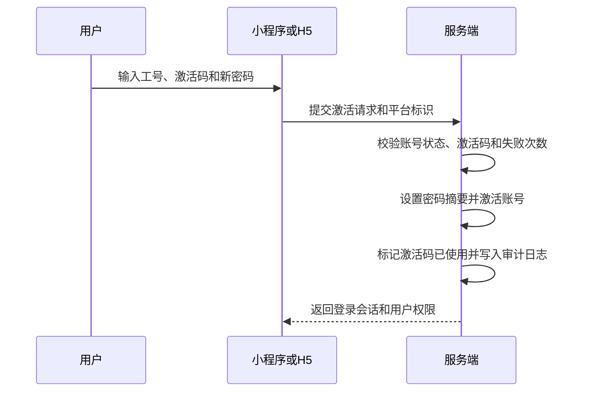
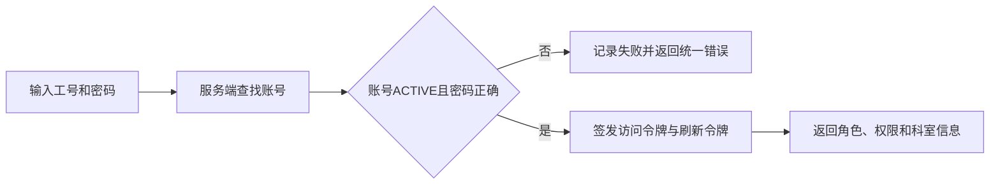
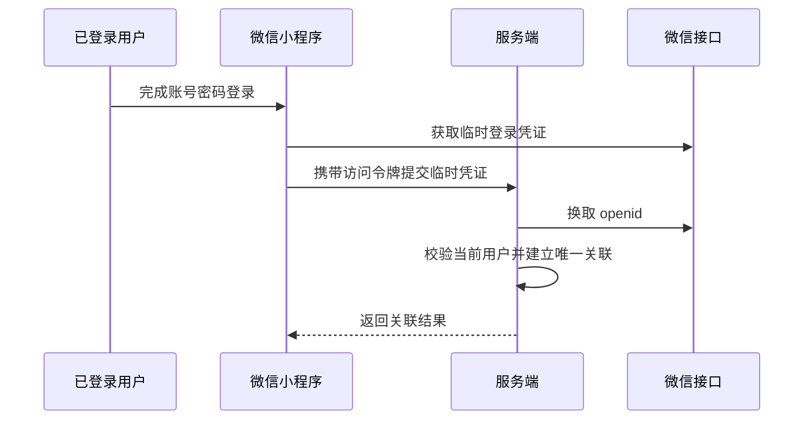

# 登录、激活与微信身份关联

> 适用需求：AUTH-01～AUTH-07  
> 决策状态：V1.0 已确认

## 1. 最终登录方案

- 护士账号由护士长预先创建，用户不能自行注册。
- 用户在微信小程序或 H5 任一端使用工号和一次性激活码完成首次激活。
- 首次激活时设置系统登录密码。
- 激活后，微信小程序和 H5 均使用同一工号与密码登录。
- 小程序登录成功后关联微信 `openid`，用于订阅消息等微信能力。
- 微信身份关联失败不影响账号密码登录，不允许仅凭 `openid` 自动创建账号。

## 2. 身份模型

系统使用内部 `user_id` 作为唯一业务身份。通知接收人、任务负责人、审核人和审计操作人均关联 `user_id`。

| 身份数据 | 用途 | 是否作为业务主键 |
| --- | --- | :---: |
| `user_id` | 系统内部唯一身份 | 是 |
| 工号 | 小程序和 H5 登录名 | 否 |
| 密码摘要 | 验证账号密码 | 否 |
| 微信 `openid` | 订阅消息及微信能力关联 | 否 |
| 微信 `unionid` | 条件允许时辅助识别 | 否 |

同一人员在小程序和 H5 使用同一个 `user_id`、工号和密码，不建立两套业务账号。

## 3. 账号状态

| 状态 | 说明 | 可登录 |
| --- | --- | :---: |
| `PENDING_ACTIVATION` | 管理员已预建，尚未完成首次激活 | 否 |
| `ACTIVE` | 已激活且在岗 | 是 |
| `LOCKED` | 连续失败或管理员临时锁定 | 否 |
| `DISABLED` | 离科或账号停用 | 否 |

## 4. 管理员预建账号

初始部署由种子程序创建唯一的首位护士长账号。当前项目约定其初始工号为 `admin`，测试环境初始密码也为 `admin`；该明文仅用于首次进入系统，不写入代码仓库，实际值由服务器环境变量注入。种子程序只在首次创建账号时设置密码，后续部署不得覆盖已经修改的密码。正式上线前必须改用符合密码规则的独立密码，并撤销初始会话。

1. 护士长录入姓名、工号、角色和护理分组。
2. 服务端检查科室内工号唯一性。
3. 服务端创建 `PENDING_ACTIVATION` 账号。
4. 护士长按需生成一次性激活码。
5. 激活码仅展示一次，服务端只保存摘要，有效期 24 小时。
6. 重新生成激活码时，之前尚未使用的激活码立即失效。

不得通过姓名搜索或仅知道姓名完成账号激活。

## 5. 首次激活流程

用户可以从小程序或 H5 发起相同的激活流程。

规则：

- 激活码单次使用，激活成功后立即失效。
- 密码至少 10 位，并同时包含字母和数字。
- 密码使用 scrypt 等适合密码存储的加盐单向派生算法保存；实现变更不得降低参数强度或改为可逆加密。
- 激活接口使用幂等键，网络重试不得重复创建身份或会话。
- 连续 5 次激活失败后，当前工号的激活尝试锁定 15 分钟。
- 激活、失败、锁定和成功时间由服务端生成并写入审计日志。
- 小程序激活成功后可以继续执行微信身份关联。

## 6. 账号密码登录

小程序和 H5 共用以下规则：

- 登录名为科室工号，V1.0 单科室场景下保持系统唯一。
- 登录失败统一提示“账号或密码不正确”。
- 连续 5 次失败锁定 15 分钟，成功登录后清零失败计数。
- `PENDING_ACTIVATION`、`LOCKED` 和 `DISABLED` 账号不得签发会话。
- 登录成功后仍需在每次 API 请求中检查账号状态和权限。

## 7. 小程序微信身份关联

规则：

- 关联操作必须在账号密码登录后进行。
- 同一 `openid` 在同一小程序 AppID 下只能关联一个有效用户。
- 同一用户在同一小程序 AppID 下只能保留一个有效关联。
- 关联失败不注销当前账号密码会话。
- `openid` 不返回给普通前端页面，不出现在导出文件中。
- 关联、解除关联和重新关联均生成审计日志。

## 8. 会话规则

- 访问令牌有效期 30 分钟。
- 刷新令牌最长有效期 14 天，每次刷新执行令牌轮换。
- 服务端仅保存刷新令牌摘要，可按设备撤销会话。
- 用户退出、停用、重置密码后撤销该用户全部刷新会话。
- 解除微信身份关联只影响微信能力，不影响当前账号密码凭据。
- H5 不将长期令牌存入可被页面脚本直接读取的持久存储。

## 9. 密码重置、微信重绑与停用

| 场景 | 操作人 | 处理规则 |
| --- | --- | --- |
| 忘记密码 | 护士长 | 生成一次性重置码，用户在任一端重新设置密码 |
| 密码重置成功 | 系统 | 撤销该用户全部旧会话，重置码立即失效 |
| 更换微信 | 护士长 | 填写原因并解除旧关联，用户登录后重新关联 |
| 误关联微信 | 护士长 | 核验身份后解除，保留完整审计记录 |
| 离科 | 护士长 | 将账号设为 `DISABLED` 并撤销全部会话 |
| 临时风险 | 护士长 | 将账号设为 `LOCKED`，解除后恢复 `ACTIVE` |

管理员不能查看、导出或手工设置用户明文密码。

## 10. 异常与并发处理

- 激活事务同时更新账号、激活码和审计日志，任何一步失败则整体回滚。
- 激活成功但响应丢失时，用户可以直接使用新密码登录。
- 并发激活同一账号时只允许一个请求成功。
- 并发关联同一微信身份时通过唯一约束保证只有一个请求成功。
- 微信接口不可用时保留账号密码登录状态，并允许稍后重新关联。
- 已停用账号不得通过旧访问令牌或刷新令牌恢复会话。

