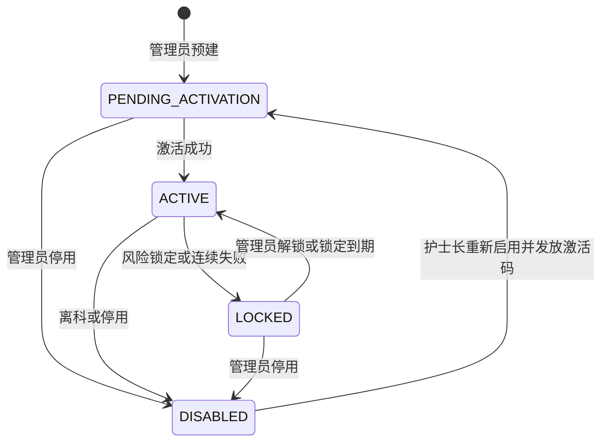
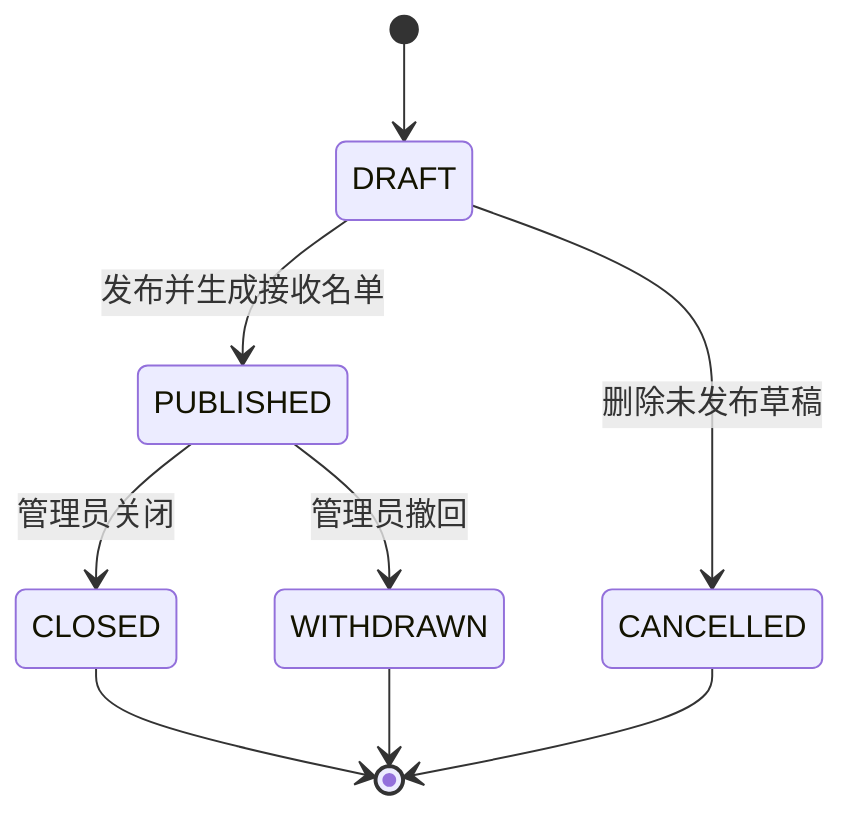
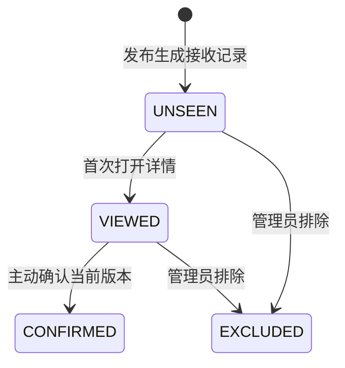
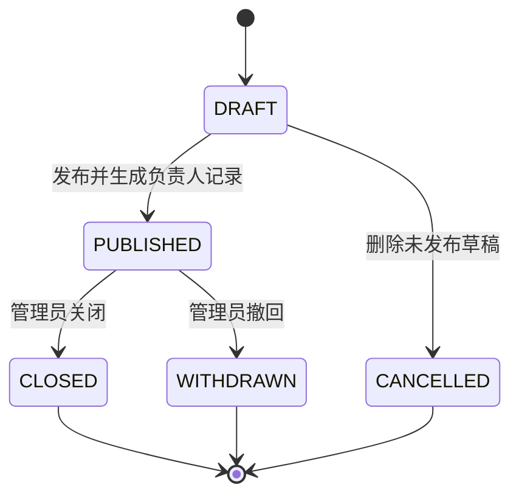
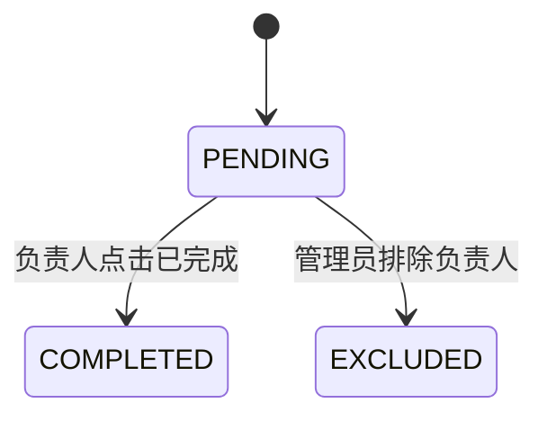
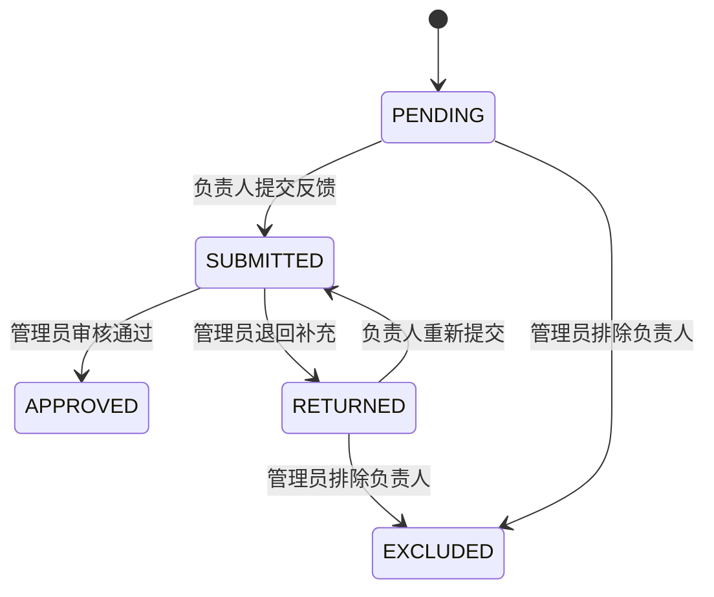

# 业务状态机

> 本文是业务状态流转的唯一基线。逾期状态根据截止时间与完成时间计算，不通过人工直接写入。

## 1. 通用规则

- 状态变更只能通过明确的业务动作发生。
- 已发布业务记录不物理删除。
- 状态变更由服务端校验并生成时间。
- 发布、撤回、关闭、确认、提交、审核和退回必须记录审计日志。
- 重复请求通过幂等键或唯一约束返回同一业务结果。

## 2. 账号状态机

`DISABLED` 不允许自行恢复。护士长执行重新启用时必须填写原因，账号进入 `PENDING_ACTIVATION`；旧会话保持失效、旧密码清除、未使用验证码作废，重新激活后进入 `ACTIVE`。最近一次停用时间与原因保留在人员记录和审计日志中。

## 3. 通知主状态

| 当前状态 | 动作 | 目标状态 | 前置条件 |
| --- | --- | --- | --- |
| `DRAFT` | 发布 | `PUBLISHED` | 字段有效、至少一名接收人、发布人有权限 |
| `DRAFT` | 删除草稿 | `CANCELLED` | 尚未发布，无接收记录 |
| `PUBLISHED` | 关闭 | `CLOSED` | 关闭原因可选，停止新增提醒 |
| `PUBLISHED` | 撤回 | `WITHDRAWN` | 撤回原因必填，通知仍可在历史中查看 |

关闭表示事项正常结束，撤回表示发布内容不再有效。两者均不删除历史确认记录。

## 4. 通知接收人状态

存储状态：

派生状态：

| 派生状态 | 判断条件 |
| --- | --- |
| `OVERDUE_UNSEEN` | 当前时间超过截止时间且未查看、未确认、未排除 |
| `OVERDUE_UNCONFIRMED` | 当前时间超过截止时间且已查看但未确认、未排除 |
| `RECONFIRM_REQUIRED` | 通知当前版本高于接收人的已确认版本且本次更新要求重新确认 |

规则：

- `viewed_at` 只记录首次查看时间。
- `confirmed_at` 和 `confirmed_version` 由服务端原子写入。
- `EXCLUDED` 必须填写原因，从有效接收人数中排除，但保留原记录。
- 发布后可以追加接收人，新接收人从当前通知版本开始处理。
- 已确认人员不能自行取消确认。

## 5. 通知版本规则

| 修改内容 | 是否生成新版本 | 是否要求重新确认 |
| --- | :---: | :---: |
| 标题、正文、重要等级 | 是 | 是，默认对全部有效接收人 |
| 通知附件增删或替换 | 是 | 是，默认对全部有效接收人 |
| 延长确认期限 | 是 | 否，保留已有确认 |
| 缩短确认期限 | 是 | 否，保留已有确认并产生变更提醒 |
| 追加接收人 | 否 | 仅新增人员确认当前版本 |
| 排除误选接收人 | 否 | 被排除人员不再需要确认 |
| 修正不影响含义的格式 | 是 | 发布人可选择不重新确认，并填写原因 |

服务端保存每个版本的完整快照、修改人、修改时间、修改原因和重新确认规则。

## 6. 任务主状态

任务发布后不得切换简单完成和审核完成模式。要求发生实质变化时，应撤回原任务并发布新任务。

管理端任务列表中的“结束”是截止时间到达后的派生展示：仅针对仍为 `PUBLISHED` 的任务，剩余时间显示 `00:00:00`。它不自动写入 `CLOSED`，也不删除任务记录；管理员关闭仍是独立业务动作。负责人明细的逾期派生状态仍按下文规则计算。

## 7. 简单任务执行状态

`OVERDUE_PENDING` 为当前时间超过截止时间且仍为 `PENDING` 的派生状态。

## 8. 审核任务执行状态

| 当前状态 | 动作 | 目标状态 | 规则 |
| --- | --- | --- | --- |
| `PENDING` | 提交 | `SUBMITTED` | 反馈满足任务要求，生成第 1 次提交 |
| `SUBMITTED` | 审核通过 | `APPROVED` | 审核人具有 `task.review` 权限 |
| `SUBMITTED` | 退回补充 | `RETURNED` | 审核意见必填 |
| `RETURNED` | 重新提交 | `SUBMITTED` | 生成新的提交序号，旧提交不可覆盖 |
| `PENDING/RETURNED` | 排除负责人 | `EXCLUDED` | 原因必填，从有效负责人统计中排除 |

派生逾期状态：

- `OVERDUE_PENDING`：截止后仍未首次提交。
- `OVERDUE_RETURNED`：截止后仍处于退回补充。
- 已在截止前提交但等待管理员审核的 `SUBMITTED` 不计为护士逾期。

## 9. 提醒状态

| 状态 | 说明 |
| --- | --- |
| `PLANNED` | 已生成提醒计划 |
| `PROCESSING` | 队列正在执行 |
| `SENT` | 渠道返回成功 |
| `FAILED_RETRYABLE` | 暂时失败，可按策略重试 |
| `FAILED_FINAL` | 达到重试上限或不可重试 |
| `CANCELLED` | 事项完成、撤回或用户被排除后取消 |

提醒发送成功不得修改通知查看、通知确认或任务完成状态。

## 10. 并发与一致性

- 发布事务同时创建主记录、版本、接收人或负责人快照和审计日志。
- 确认使用通知 ID、用户 ID 和版本号唯一约束。
- 任务提交序号在同一执行记录内唯一并递增。
- 审核使用当前状态条件更新，避免两名管理员重复审核。
- 状态冲突返回当前服务端状态，客户端刷新详情后继续处理。

